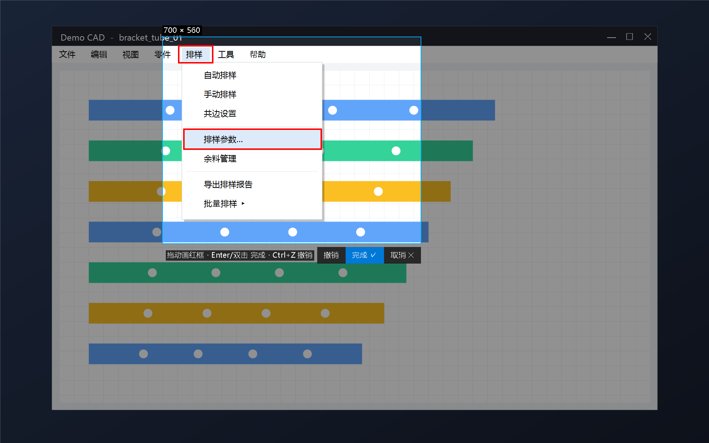
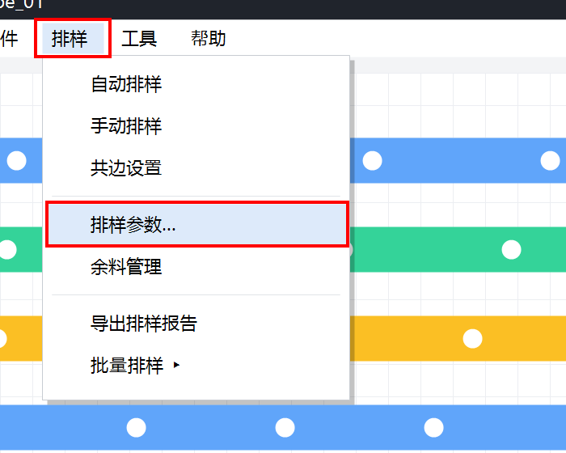

<div align="center">

[简体中文](README.md) | [English](README.en.md) | [繁體中文](README.zh-TW.md) | [日本語](README.ja.md) | [한국어](README.ko.md) | **Русский**


# MiniShot

**Крошечная утилита для скриншотов, которая снимает открытые выпадающие меню — 32 КБ, без установки**

Выпадающее меню закрывается, как только вы нажимаете клавишу скриншота? MiniShot перехватывает клавишу на системном уровне: приложение ничего не получает, и меню остаётся открытым.


### [⬇️ Скачать последнюю версию](https://github.com/RickLisfdsdf/MiniShot/releases/latest)

</div>

> **Примечание:** интерфейс пока **только на упрощённом китайском**. Горячие клавиши работают одинаково независимо от языка.



## Зачем

Многие программы (особенно на Delphi/VCL, промышленные и CAD-приложения) закрывают выпадающие меню **при любом нажатии клавиши или потере фокуса**:

- PrtSc: Windows 11 запускает «Ножницы», которые забирают фокус — меню закрывается
- Ctrl+Shift+S и подобные сочетания: Ctrl/Alt попадает в приложение в момент нажатия — меню закрывается
- Отложенный снимок работает, но каждый раз нужно ждать несколько секунд

**MiniShot** ставит низкоуровневый хук клавиатуры и «проглатывает» нажатие и отпускание клавиши захвата. Во время захвата окна не показываются: сначала весь экран фиксируется в картинку, затем вы выделяете область.

## Возможности

| | |
|---|---|
| 📌 **Снимает выпадающие меню** | Клавиша перехватывается на уровне системы, активное приложение её не видит и не теряет фокус |
| ✂️ **Выделение + красные рамки** | Выделите область на замороженном экране и рисуйте внутри красные рамки (несколько, с отменой) |
| 📋 **Автосохранение + копирование** | Копия в буфер обмена и PNG-файл (по умолчанию на рабочий стол) |
| ⌨️ **Своя клавиша захвата** | PrtSc работает всегда; можно добавить любую одиночную клавишу, например Fn+F1 на ноутбуке |
| ⏱️ **Отложенный снимок** | Через 3 / 5 секунд из меню в трее |
| 🖱️ **«Вставить скриншот» в проводнике** | Правый клик по пустому месту папки или рабочего стола сохраняет картинку из буфера в PNG; можно добавить в **верхний уровень меню Windows 11** |
| 🪶 **Крошечная** | exe 32 КБ, ~4 МБ ОЗУ в простое, без установки (встроенный .NET Framework 4) |
| 🖥️ **High DPI** | Масштаб 150% / 200% и несколько мониторов |

| Результат |
|---|
|  |

## Быстрый старт

1. Скачайте zip из [Releases](https://github.com/RickLisfdsdf/MiniShot/releases/latest) и распакуйте в **постоянную папку**
2. Запустите `MiniShot.exe` — в трее появится значок
3. **PrtSc** → выделите область → рисуйте рамки внутри → **Enter** или двойной щелчок для сохранения

| Действие | Клавиша |
|---|---|
| Снимок | PrtSc (или своя клавиша) |
| Весь экран | Enter без выделения |
| Красная рамка | Перетаскивание внутри выделения |
| Отменить | Ctrl+Z |
| Сохранить | Enter / двойной щелчок |
| Отмена | Esc / правый клик |

### Необязательно: пункт в верхнем уровне контекстного меню Windows 11

1. Параметры → Система → Для разработчиков → включите **Режим разработчика**
2. Правый клик по `install-menu.ps1` → Выполнить с помощью PowerShell
3. Правый клик по пустому месту папки — пункт «粘贴截图» (вставить скриншот) будет на первом уровне (если нет — перезапустите проводник)

## Как это работает

```
Нажата PrtSc
   ├─ Хук WH_KEYBOARD_LL возвращает 1 для нажатия и отпускания → приложение ничего не получает, меню открыто
   ├─ CopyFromScreen снимает весь виртуальный экран (окон ещё нет)
   └─ Полноэкранное окно поверх всех показывает снимок → выделение → рамки → сохранение
```

Только одиночные клавиши: модификаторы Ctrl/Alt попадают в приложение в момент нажатия.

## Сборка

Запустите `build.bat`. `MiniShot.exe` собирается встроенным в Windows `csc.exe` — ничего устанавливать не нужно. Для `MiniShotMenu.dll` нужны VS 2022 Build Tools.

<details>
<summary><b>FAQ</b></summary>

**Нажатие ничего не делает:** если активное приложение запущено от администратора, MiniShot тоже нужно запустить от администратора.

**Нет клавиши PrtSc:** трей → «设置截图键» → нажмите нужную клавишу (например, Fn+F1).

**Антивирус ругается:** неподписанные утилиты с глобальным хуком клавиатуры иногда дают ложные срабатывания. Весь код открыт.

</details>

## Понравилось?

Поставьте ⭐ Star — это очень помогает!

## License

[MIT](LICENSE)
